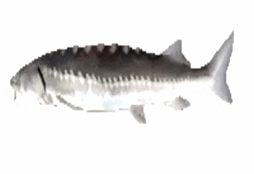

<div align="center">
  <h1>fish-screen</h1>
  <p>A rotating fish for your Linux terminal.</p>
  
  <p><a href="#quick-start">Quick start</a> · <a href="#controls">Controls</a> · <a href="#options">Options</a></p>
</div>

## Quick start

On Linux, install Git and a current stable Rust toolchain with Cargo.

```sh
git clone https://github.com/Tereegor/fish-screen.git
cd fish-screen
cargo install --locked --path .
fish-screen
```

The fish fills up to 80% of the terminal by default. The animation is built into the binary, so you can launch it from any directory. Press `q` or `Esc` to quit.

## Display modes

| Mode | Display |
| --- | --- |
| `ascii` | Text shading with ASCII characters. At larger glyph sizes, the characters are drawn with Unicode Braille dots. |
| `blocks` | A silhouette shaded with block characters. |
| `original` | Pixel rendering at the GIF's frame cadence in a direct Kitty session outside tmux. Falls back to ASCII elsewhere. |

The text modes blend adjacent frames to smooth the motion. The animation fits the terminal using the reported character cell dimensions, with a 1:2 width-to-height fallback.

```sh
fish-screen --mode blocks --glyph-size 2
fish-screen --mode original --fg '#ffbf69' --bg '#101418' --size 65 --speed 0.75
fish-screen --gif ./assets/fish.gif
```

## Controls

| Key | Action |
| --- | --- |
| `Space` | Pause or resume |
| `+` / `=`, `-` | Enlarge or shrink glyphs while keeping the overall animation size |
| `1`, `2` | Speed up or slow down by a factor of 1.25 |
| `3`, `4`, `5` | Switch to ASCII, blocks, or pixel rendering |
| `g` | Toggle pixel rendering in Kitty |
| `q`, `Esc`, `Ctrl+C` | Quit |

The size, speed and mode keys also accept `Ctrl` if the terminal passes the shortcut through.

## Options

| Flag | Default | What it changes |
| --- | --- | --- |
| `--gif PATH` | Built-in fish | Play a GIF from disk |
| `--mode MODE` | `ascii` | Start in `ascii`, `blocks`, or `original` mode |
| `--fg COLOR` | `white` | Foreground color |
| `--bg COLOR` | `black` | Background color |
| `--size PERCENT` | `80` | Maximum share of the terminal's width and height, from 1 to 100 |
| `--speed FACTOR` | `1.0` | Playback speed, from 0.25× to 4× |
| `--fps FPS` | `60` | Target refresh rate for text rendering, from 1 to 120 |
| `--glyph-size SIZE` | `1` | Text glyph size, from 1 to 4 |

Colors accept a quoted `'#RRGGBB'` value or one of `black`, `red`, `green`, `yellow`, `blue`, `magenta`, `cyan`, and `white`.

## Development

Run the tests with `cargo test --locked`.
